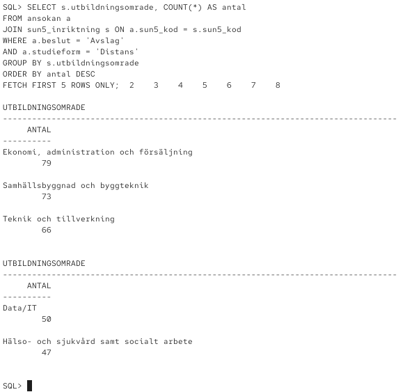
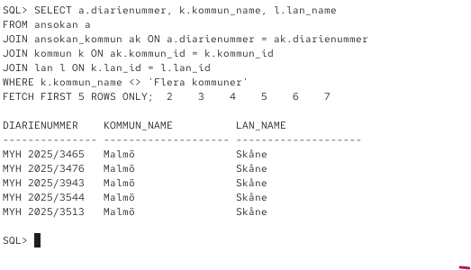

# The Skool - SQL analys

## Data

Datamängden kommer från MYH och innehålller 1184 ansökningar från 2025.

Datan har importerats till tabellen `myh_2025`.

## SQL-filer

- `00_create_table.sql` - Skapar originaltabellen.
- `01_eda.sql` - Undersöker datan med SQL frågor.
- `03_datadrivna_beslut.sql` - Tre egna frågor som kan hjälpa The Skool.
- `04_datamodell.sql` - Skapar och fyller tabelerna i datamodellen.
- `04_bonus_fragor.sql` - SQL frågor som använder den nya datamodellen.

## Datadrivna beslut

Jag har undersökt tre frågor:

1. Vilka fem utbildningsanordnare har flest beviljade ansökningar?

2. Vilka utbildningsområden har flest avslag för distansutbildningar?
3. Vilka fem kommuner har flest beviljade ansökningar inom Data/IT?

Frågorna kan hjälpa The Skool att undersöka konkurrans och se vilka utbildningsområden och kommuner som är intressanta.

## Bonusuppgift - Datamodell

Jag har delat upp originaldatan i sju tabeler:

- `lan`
- `kommun`
- `utbildningsanordnare`
- `seqf`
- `sun5_inriktning`
- `ansokan`
- `ansokan_kommun`

Tabellerna är kopplade med primär och främmande nycklar.

Jag har även gjort om SQL frågorna från uppgift 1 så att de använder den nya datamodellen istället för originaltabellen.

## Tester

Jag har kontrollerat att alla 1184 ansökningar finns med i den nya datamodellen.

Jag har också gämfört resultaten mellan originaltabellen och de nya tabellerna för att kontrollera att de ger samma resultat.

## Verktyg

- Oracle Database
- Oracle SQL
- Oracle Linux
- Podman
- Vim
- Git och Github

## AI
Jag har använt LLM för att hjälpa mig förstå vissa delar uppgifterna specifikt uppdelningen i datamodellen samt för felsökning vid tillfällen.

## Screenshots

### Datamodell

Bilden visar hur ansokningar kopplas till kommuner och lan.

### Analys

Bilden visar de fem utbildningsomradena med flest avslag
for distansutbildningar. Resultatet kan hjalpa The Skool
att undersoka konkurrensen inom olika omraden.
